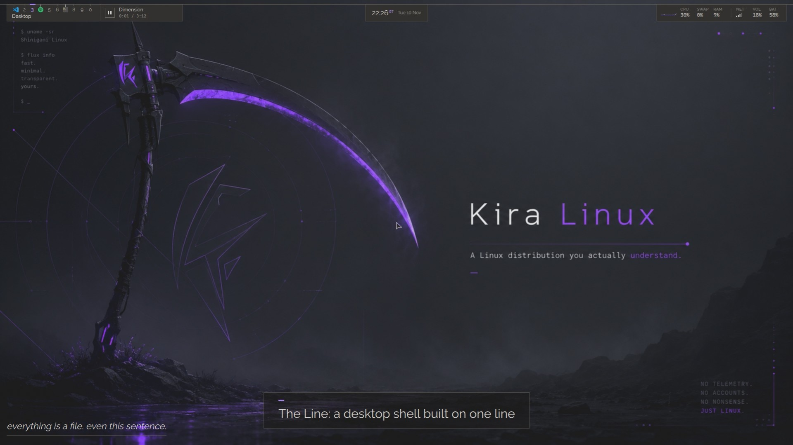
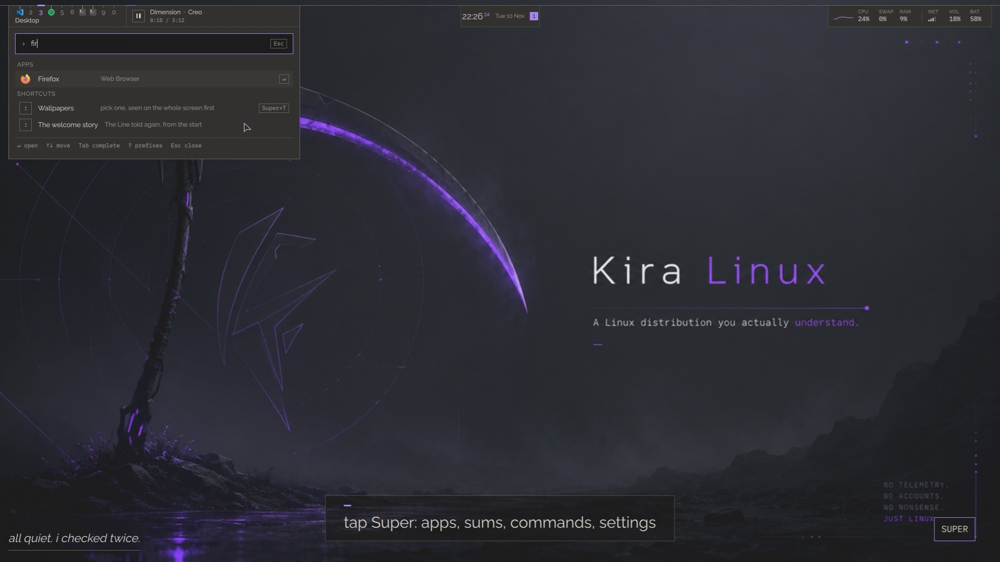
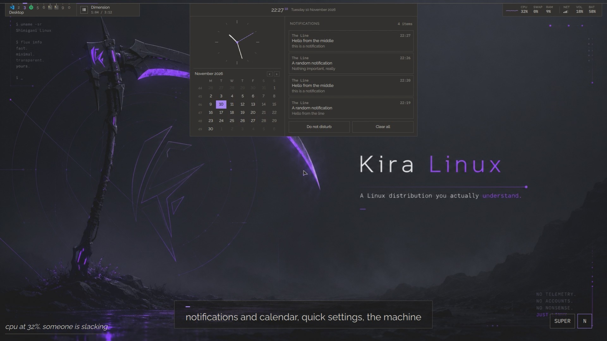
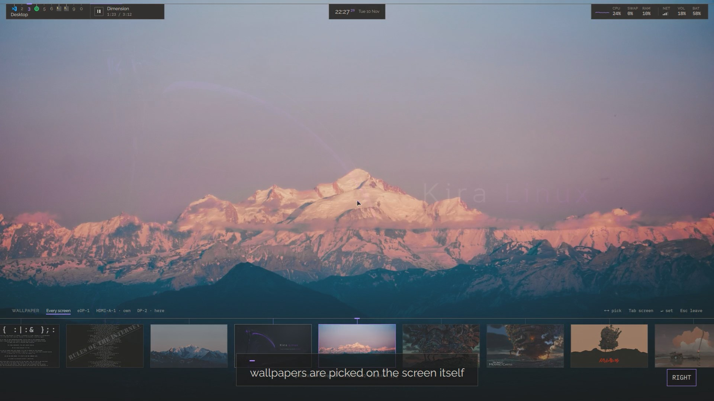

<h1 align="center">The Line</h1>

<p align="center">
  <a href="https://kira-linux.com/watch"></a>
</p>

<p align="center">
  <em>A desktop shell built on one line.</em><br>
  Quickshell on Hyprland, made for Kira Linux.
</p>

<p align="center">
  <a href="https://kira-linux.com/watch"><b>▶ Watch the demo</b></a> (under 2 minutes, full screen, with its music)
  &nbsp;·&nbsp; <a href="#install">Install</a>
  &nbsp;·&nbsp; <a href="#a-tour">A tour</a>
  &nbsp;·&nbsp; <a href="#keys">Keys</a>
  &nbsp;·&nbsp; <a href="#make-it-yours">Make it yours</a>
</p>

---

There is no dock, no taskbar and no panel. A single line crosses the top of the screen, and everything happens on it:
workspaces hang from it, a notification runs along it, the volume is drawn on it, music plays out on it. Three small
tiles sit beneath it, and when you need more they **grow into panels** instead of opening popups: the clock becomes a
calendar, the launcher unfolds from the workspaces, the machine's state opens into a dashboard. When something goes
fullscreen the tiles fold into the line and the line steps aside.

Square corners, 1 px greys, one accent colour, one curve for every movement. Nothing is hidden behind a menu, and
there is no telemetry: the one request The Line makes by itself is the public-address line of Settings › Network, and only
while that page is open.

## Install

On Kira Linux it is one command, which installs The Line with Hyprland, Quickshell, the programs it relies on and
[The Line UI](https://github.com/shinigami-os/the-line-ui) (its design language, `kira-the-line-ui`):

```sh
sudo flux install kira-the-line
```

Elsewhere you need [Quickshell](https://quickshell.org) 0.3+ and [Hyprland](https://hypr.land) 0.55+ (the session's configuration is
Lua), plus a few small programs. The shell draws with The Line UI, which is a QML module of its own, so clone the two
side by side. The installer tells you exactly what is missing, and installs The Line UI from the checkout next to it:

```sh
git clone git@github.com:shinigami-os/the-line-ui.git
git clone git@github.com:shinigami-os/the-line.git
cd the-line
./install.sh --check        # what is found, what is missing
sudo ./install.sh           # installs under /usr; log out and pick "The Line" in your login screen
```

| | |
|---|---|
| `sudo ./install.sh` | install or update (a new tree is swapped in; your settings are never touched) |
| `sudo ./install.sh --dev` | link `/usr/share/the-line` (and The Line UI, from the checkout next to it) to the checkouts: what you edit is live (the shell reloads by itself) |
| `sudo ./install.sh --ui=DIR` | install The Line UI from a checkout in another place than `../the-line-ui` (also `THE_LINE_UI=DIR`); run it again to update it |
| `sudo ./install.sh --greeter` | also put The Line's own login screen first in greetd (Kira's `start-greeter.sh`) |
| `sudo ./install.sh --uninstall` | remove it; `~/.config/the-line` stays, and so does The Line UI (other apps use it too) |
| `DESTDIR=/tmp/pkg ./install.sh` | stage it for packaging (no root, no checks; The Line UI is its own package) |

**Required:** [The Line UI](https://github.com/shinigami-os/the-line-ui) (the design language, a QML module of its own: `kira-the-line-ui` on Kira, installed by `install.sh` from a checkout otherwise), `qs` (Quickshell), `Hyprland` and `start-hyprland`, `dbus-run-session`, PipeWire and WirePlumber (`wpctl`),
`nmcli` (NetworkManager), `loginctl`, `grim`, `wl-copy` (wl-clipboard), `cliphist`, `hypridle`, `foot`, `python3`.
**Recommended:** `brightnessctl`, `playerctl`, `qalc`, `cava`, `qt6ct`, `jq`, `slurp`, `matugen`, `mpv`.
**Optional:** `hyprsunset` (night light), `hyprpicker`, `flameshot`, `wf-recorder`, `tesseract`, `yazi`, `howdy`
(face sign-in), `fprintd` (fingerprint), `cage` (the login screen), and [Voxel](https://github.com/AxOS-project/Voxel) as the
graphical file manager (`kira-voxel` on Kira Linux). Qt Multimedia (ffmpeg backend) for video wallpapers;
Kvantum and adw-gtk3 so other apps wear The Line's colours. Fonts: Raleway and IBM Plex Mono (JetBrains Mono is the fallback).

It runs on one screen or several (the ten workspaces are shared out between them, the main screen first). There is no
GPU-specific code: integrated graphics is enough. It is built and tested on Kira Linux (runit); the session and the
settings helper also handle systemd, but that is less travelled.

The first login tells the story of the line in a few minutes (every screen black, then Kira explaining, with offers to
change a setting on the spot). Type `welcome` in the launcher to hear it again.

## A tour

<p align="center">
  
</p>

**The launcher** grows out of the workspace tile (tap Super). It finds apps (most launched first), solves sums (`qalc`),
runs commands, and knows where every setting is ("wifi" offers *Settings › Network*). A first character narrows it:
`=` calculate, `>` run, `:` shortcuts, `/` settings, `?` lists them. Double-tap Super for the **workspace overview**:
ten small screens with live thumbnails; drag a window onto another workspace, click one to focus it.

<p align="center">
  
</p>

**Tiles and panels.** Left: workspaces, the focused window, and the music that is playing (with its progress drawn on the
line). Middle: the clock, which becomes the notifications and calendar; notifications arrive as a pulse along the line
and a toast. Right: CPU, RAM, network, volume, battery; it opens into quick settings (Wi-Fi, Bluetooth, night light,
keep awake, sliders, power) and a performance dashboard. Volume, brightness and keyboard backlight changes are drawn on
the line itself.

**Windows.** Tiling by Hyprland, with the shell's own curve and timings. Float any window (it is remembered, with its size
and place), a resize mode on the arrows, and a **fullscreen** that plays in stages: the music part leaves, the tiles fold
into the line, the line withdraws. Push the pointer against the top edge for 400 ms and it all comes back until the
pointer leaves.

**Music.** MPRIS players show on the left tile; the panel has the cover, a track ruler with seek and the controls.
`SUPER+M` turns the line into a **visualiser**: the frequencies hang from it as ticks, one every 6 px on any screen
(needs `cava`; off at every login).

<p align="center">
  
</p>

**Wallpapers and colours.** `SUPER+T`: the wallpapers hang from a line across the bottom and the screen previews the
picked one, for every screen or one. Pictures, animated GIFs and videos (they stop under a fullscreen window and on
battery). The accent can follow the wallpaper. Other apps wear the same colours: GTK 3/4 through `gtk.css` (adw-gtk3),
Qt through a recoloured Kvantum theme, plus their icon theme (Qt through qt6ct), all rewritten at each accent change.

**A settings app** (`SUPER+I`) with a spine of sections and a search over every setting: network, Bluetooth, sound,
displays (an arrangement map that snaps, resolution, scale, rotation, main screen; changes go back after 15 s unless
kept), input, appearance, workspaces, shortcuts (yours, and The Line's own, moved or turned off; conflicts refused),
power and idle (with a battery charge limit), notifications (do not disturb on a schedule), night light, storage, default
apps, sign-in (howdy faces, fingerprint), system (name, time, time zone), and about.

**Lock and login.** The lock screen (`SUPER+L`, idle, before sleep): the line glides to the middle pulling the night over
the screen, the time above it, the password typed as ticks on it, and unlocking runs the accent along it before it rises
back. A face (howdy) or a fingerprint (fprintd) can be tried first: three tries a lock, then the password. The login
screen is the line too: two dials of ticks turning off the left edge; signing in winds them up until they shed their
ticks onto the line. The numpad types digits whatever NumLock says.

**And the rest.** A cheat sheet that reads every shortcut live (`SUPER+F1`), a power menu you hold to confirm, clipboard
history (`SUPER+V`), an emoji picker (`SUPER+;`), a polkit dialog drawn as the line, screenshots and screen recording
that say so when they start and stop, a notification daemon, and **Kira's voice**: on an empty workspace, quietly, she
says something (from `assets/quotes.txt` plus your own `~/.config/the-line/quotes.txt`). There are easter eggs; finding
them is your job (`EASTER_EGGS.md` has the spoilers).

## Keys

| | |
|---|---|
| **tap `Super`** · **double-tap** | launcher · workspace overview |
| `Super+1…0` · `Super+Ctrl+1…0` · `Super+Shift+1…0` | go to a workspace · send the window there · send it and follow |
| `Super+arrows` (or `U H J K`) · with `Shift` | focus · move the window |
| `Super+F` · `Super+Alt+Space` · `Super+Y` · `Super+R` · `Super+Q` | fullscreen · float or tile · toggle split · resize mode · close |
| `Super+N` · `Super+A` · `Super+P` | notifications and calendar · quick settings · performance |
| `Super+T` · `Super+M` · `Super+V` · `Super+;` | wallpapers · music visualiser · clipboard · emoji |
| `Super+I` · `Super+L` · `Super+F1` · `Ctrl+Alt+Delete` | settings · lock · every shortcut · power menu |
| `Print` · `Super+Shift+S` · `Super+Alt+R` | screenshot · Flameshot · record an area |

Every one of them can be moved or turned off in Settings › Shortcuts. In your own Hyprland config the shell's
shortcuts are global shortcuts under the `the-line` app id: `hl.bind("SUPER+N", hl.dsp.global("the-line:notifications"))`.

## Make it yours

Everything you set lives in `~/.config/the-line/` (state such as launch counts in `~/.local/state/the-line/`); updates only
replace `/usr/share/the-line`. `config.json` is the source; the files other programs read (`hypridle.conf`,
`hypr/workspaces.lua`, `hypr/input.lua`, `hypr/keys.lua`, `hypr/floating.lua`) are generated from it, and each file says in
its first lines whether it is yours. `~/.config/the-line/README.md`, written at each login, lists them all.

Yours to edit in `~/.config/the-line/hypr/`: `monitors.lua`, `apps.lua` (your app keys), `custom.lua` (loaded last). Coming
from Sleex, its monitors, app keys and general settings are copied there on the first login. Every key of `config.json` is
optional:

```json
{ "accent": "#9A5CFF", "accentFromWallpaper": false, "reduceMotion": false, "motionScale": 1.0,
  "terminal": "foot", "primaryScreen": "", "wallpaper": "…/default.png", "wallpapers": { "DP-2": "/path/to/own.mp4" },
  "wallpaperStillOnBattery": true, "workspaceIcons": false, "kiraVoice": true, "levelStep": 2,
  "clipboardMax": 200, "clipboardImages": true, "clipboardWipeOnLogin": false, "unlockBiometrics": false }
```

## Under the hood

```
shell.qml         entry point and the IPC (`qs -p . ipc show`); the colours, motion and shared parts come from TheLine.Ui
services/         singletons: Config, Theme, Anim, UiState, LineState, Notifs, Audio, Media, Network, Lock, Welcome, ...
modules/          line/ (the line and the per-screen surface), tiles/ (the three tiles and their panels),
                  desktop/ (wallpaper, pickers, dialogs, Kira's voice), lock/, welcome/, demo/
settings/         the settings app (its own window)
greeter/          the login screen (greetd, under cage) and its installer
session/          the session: environment, Hyprland's Lua config, the helpers, the .desktop, the polkit policy
assets/           quotes, the story, emoji, icons, wallpapers
cursor/           build.py draws The Line's cursor theme (Python and Pillow, nothing else)
scripts/          build-emoji.py, and video/ (the runner that films the demo)
install.sh        installer
```

The shell reads from `/usr/share/the-line` (or `THE_LINE_DIR`). To work on it from a checkout, `sudo ./install.sh --dev`,
or run it by hand:

```sh
qs -p /path/to/the-line                          # THE_LINE_SCREENS=HDMI-A-1 for one screen only
qs -p . ipc call line notify build "cargo build finished" "0 errors"
qs -p . ipc call line gauge vol 0.64             # the line as a volume bar
qs -p . ipc call line toggle eDP-1 tc            # a panel: tl launcher, tm music, tc notifications, tr quick settings, tp performance
qs -p . ipc call line search fire                # the launcher with a search typed in
qs -p . ipc call line wallpapers                 # also: overview, cheatsheet, power, visualiser, say "hello"
qs -p . ipc call line welcomeHere                # the welcome story on the focused screen only
qs -p . ipc call line lockTest 15                # a lock that opens by itself after 15 s
QS_TESTING=1 QS_SCREEN=<screen> qs -p greeter    # the login screen, inside a session ("test" signs in, Esc leaves)
```

The session (`session/`) runs from the login screen: `the-line-session` sets the environment and the buses and starts
Hyprland with `hyprland.lua`, which starts `the-line-shell` (the shell, restarted if it crashes). Workspaces are shared out
evenly between screens, left to right (2 screens: 1 and 5; 3 screens: 1, 4, 7; the main screen first). The Hyprland layer
rule `no_anim` for the `the-line` namespace stops its own fade on the surface: the shell animates itself.

The demo video is filmed by a script, not by hand: `scripts/video/` has the runner and the script it follows (captions and
the pressed keys are drawn by the shell, `modules/demo/`).

## License

The Line is free software under the [GNU General Public License v3.0 or later](LICENSE): you can use, study, change and
share it, and what you share stays under the same terms. Copyright © 2026 OxoGhost.

---

Made by [OxoGhost](https://github.com/OxoGhost01) for [Kira Linux](https://kira-linux.com).
